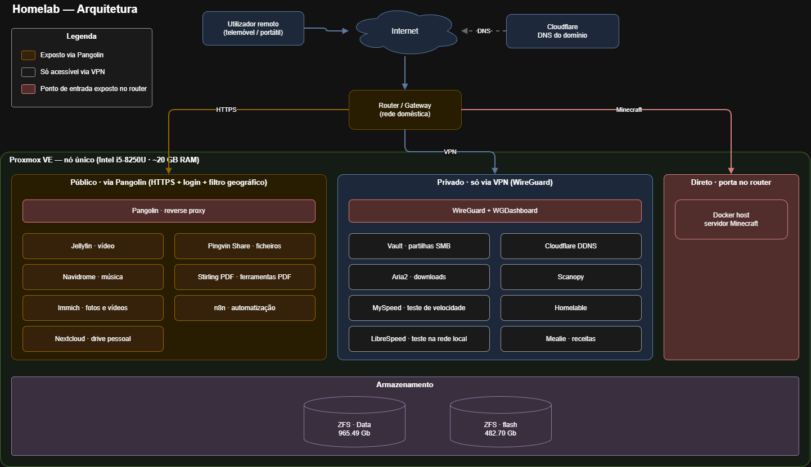

# Homelab

Servidor Proxmox VE de nó único que aloja serviços auto-alojados,
maioritariamente em contentores LXC, com acesso remoto via WireGuard
e Pangolin e armazenamento em ZFS.

## Objetivos

- Aprender virtualização, redes e gestão de infraestrutura na prática
- Substituir serviços cloud por alternativas self-hosted
- Documentar e reproduzir a infraestrutura

## Arquitetura

## Hardware
| Componente | Especificação |
|---|---|
| CPU | Intel Core i5-8250U |
| RAM | ~20 GB |
| Boot | SSD 238 GiB |
| Armazenamento | ZFS: 931 GiB + 465 GiB |

## Serviços

| Serviço | Função | Tipo | Instalação | Exposto? |
|---|---|---|---|---|
| Vault (Ubuntu + Cockpit) | Armazenamento partilhado e SMB | LXC | Manual | VPN |
| [WireGuard + WGDashboard](docs/services/wireguard.md) | Acesso VPN à rede interna | LXC | Community-Scripts | Direto (UDP) |
| [Jellyfin](docs/services/jellyfin.md) | Streaming de vídeo | LXC | Community-Scripts | Pangolin |
| [MySpeed](docs/services/myspeed.md) | Teste de velocidade automático | LXC | Community-Scripts | VPN |
| [Docker](docs/services/docker.md) | Host Docker e servidor Minecraft | LXC + Docker | Community-Scripts + Docker Compose | Direto (Minecraft) |
| [LibreSpeed](docs/services/librespeed.md) | Teste de velocidade interno | LXC | Community-Scripts | VPN |
| [Navidrome](docs/services/navidrome.md) | Streaming de áudio | LXC | Community-Scripts | Pangolin |
| [Aria2](docs/services/aria2.md) | Gestor de downloads | LXC | Community-Scripts | VPN |
| [Pingvin Share](docs/services/pingvin.md) | Partilha de ficheiros | LXC + Docker | Docker Compose | Pangolin |
| [Stirling PDF](docs/services/stirling-pdf.md) | Ferramentas de PDF | LXC | Community-Scripts | Pangolin |
| [Nextcloud](docs/services/nextcloud.md) | Drive pessoal (desativado) | LXC + Docker | Docker Compose | Pangolin |
| [n8n](docs/services/n8n.md) | Automatização de workflows | LXC + Docker | Docker Compose | Pangolin |
| Immich | Backup de fotos e vídeos | LXC | Community-Scripts | Pangolin |
| Pangolin | Reverse proxy zero-trust | LXC + Docker | Docker Compose | Direto |
| Cloudflare DDNS | Atualização do DNS dinâmico | LXC | Community-Scripts | VPN |

## Rede e acesso remoto

O acesso divide-se em dois caminhos, consoante o objetivo:

**Serviços públicos (Pangolin)**
Os serviços que uso fora de casa, como Jellyfin, Navidrome e Nextcloud,
são expostos através do Pangolin, que funciona como reverse proxy com
túnel e gere automaticamente os certificados HTTPS. O Cloudflare DDNS
mantém o domínio apontado para o IP atual, já que o IP doméstico é
dinâmico.

**Acesso administrativo (WireGuard)**
Para manutenção uso o WireGuard, que dá acesso completo à rede interna.
A gestão da infraestrutura nunca passa pela internet pública.

| Tipo de acesso | Ferramenta | Para quê |
|---|---|---|
| Público | Pangolin + Cloudflare DDNS | Serviços de utilização diária |
| Privado | WireGuard | Administração e manutenção |
| Público (direto) | Porta dedicada | Servidor de Minecraft |

## Segurança

### Princípios
- **Superfície de exposição mínima:** só o necessário está acessível
  a partir da internet.
- **Administração só por VPN:** Proxmox, SSH e Portainer nunca são
  expostos.
- **Autenticação em camadas:** os serviços com login próprio usam-no;
  os restantes ficam protegidos pelo login do Pangolin.
- **Restrição geográfica:** o Pangolin bloqueia acessos de fora de
  Portugal e da Suíça.
- **HTTPS em tudo o que é público**, com certificados geridos
  automaticamente.

### Superfície exposta
| Componente | Exposto? | Proteção |
|---|---|---|
| Serviços web (Jellyfin, Nextcloud, ...) | Sim | HTTPS, login, filtro geográfico |
| WireGuard | Sim (UDP) | Autenticação por chaves |
| Servidor Minecraft | Sim | Whitelist |
| Proxmox, SSH, Portainer | Não | Apenas via VPN |

## Backups

Atualmente não existe uma estratégia de backups implementada, devido
à falta de capacidade de armazenamento e de hardware disponível. Sei
que isto representa um risco: uma falha de disco pode causar perda de
dados.

**Planeado:**
- Snapshots ZFS regulares
- Cópia dos dados importantes para um disco externo ou segundo
  dispositivo, seguindo a regra 3-2-1

## Lições aprendidas

- **Armazenamento partilhado:** gerir o acesso a dados comuns entre
  várias VMs e contentores LXC, incluindo permissões e partilhas SMB.
- **Redes no mesmo host:** configurar e manusear várias interfaces de
  rede dentro do mesmo servidor Proxmox.
- **Limites de hardware:** adaptar as soluções às restrições físicas
  do equipamento (RAM, armazenamento, expansão).

## Próximos passos

- [ ] Migrar para um host com mais capacidade de processamento e
      possibilidade de upgrades (PCIe)
- [ ] Ativar os serviços que estão desligados por falta de recursos
- [ ] Instalar o Home Assistant para controlar os dispositivos IoT da habitação
- [ ] Implementar a estratégia de backups
- [ ] Documentar cada serviço em `docs/services/`