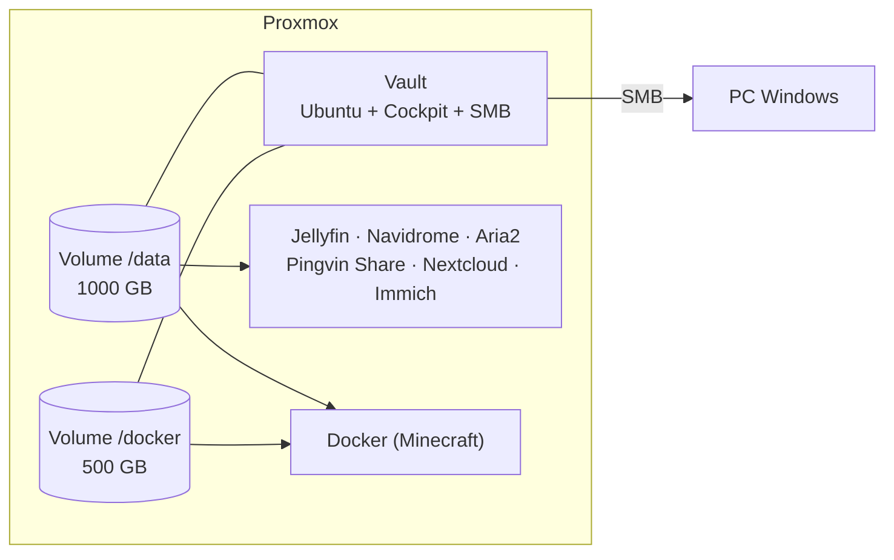

# Vault (armazenamento partilhado)

**Função:** armazenamento partilhado entre contentores e acesso por SMB a partir do PC
**Tipo:** contentor LXC (privilegiado) com Ubuntu
**Instalação:** manual
**Acesso:** apenas rede interna e VPN

> O nome "Vault" refere-se a um cofre de ficheiros, e **não** tem
> relação com o HashiCorp Vault (gestor de segredos).

## Porquê o Vault

Vários serviços do homelab precisam de aceder aos mesmos ficheiros: a
biblioteca de media, as descargas e os dados dos serviços Docker. Em
vez de cada contentor guardar a sua própria cópia, os dados ficam num
único sítio, e este contentor é o responsável por eles.

O Vault faz duas coisas:

1. **É o dono dos volumes partilhados**, que os restantes contentores
   montam diretamente.
2. **Partilha esses volumes por SMB**, para que eu possa aceder a eles
   a partir do PC com Windows.

## Como funciona



- Os volumes são discos do Proxmox criados para o Vault e montados nos
  outros contentores através de *mount points*, por isso o acesso entre
  contentores é direto, sem passar pela rede.
- O acesso a partir do PC é feito por SMB, servido pelo Vault.

## Ferramentas instaladas

- **Cockpit:** interface web para gerir o Ubuntu (serviços, armazenamento,
  terminal, utilizadores), sem precisar de usar sempre o SSH.
- **cockpit-file-sharing** (45Drives): extensão do Cockpit que permite
  gerir as partilhas SMB através de uma interface gráfica, em vez de
  editar ficheiros de configuração à mão.

## Para que uso o acesso por SMB

Com as partilhas montadas no Windows consigo:

- editar os ficheiros Docker Compose e as configurações dos serviços
  com um editor no PC;
- gerir a biblioteca de media (copiar, organizar e renomear ficheiros);
- fazer cópias e mover ficheiros entre o PC e o servidor.

## Recursos

| Recurso | Valor |
|---|---|
| CPU | 2 cores |
| RAM | 1 GB (+ 512 MB de swap) |
| Disco do contentor | 16 GB |
| Volume `/data` | 1000 GB |
| Volume `/docker` | 500 GB |

## Configuração relevante do contentor

```
unprivileged: 0
features: nesting=1
startup: order=1
onboot: 1
mp0: data:<volume>,mp=/data,size=1000G
mp1: disks:<volume>,mp=/docker,size=500G
```

- `startup: order=1` faz com que seja um dos primeiros contentores a
  arrancar, porque os outros dependem dos volumes que ele gere.
- O contentor é **privilegiado**.

## Segurança

- Nenhuma porta do Cockpit ou do SMB está aberta no router: só são
  acessíveis a partir da rede interna ou através da VPN.
- As partilhas SMB não são expostas à internet, mesmo que os serviços
  que usam os mesmos dados (como o Jellyfin) o sejam através do
  Pangolin.

## Melhorias previstas

- Incluir os dois volumes na futura estratégia de backups. É o ponto
  mais importante, porque todos os dados do homelab dependem deste
  contentor.
- Separar as partilhas SMB por finalidade (media, Docker, outras) e
  dar a cada uma apenas as permissões necessárias.
- Documentar a gestão de permissões entre contentores privilegiados e
  não privilegiados que acedem ao mesmo volume.
